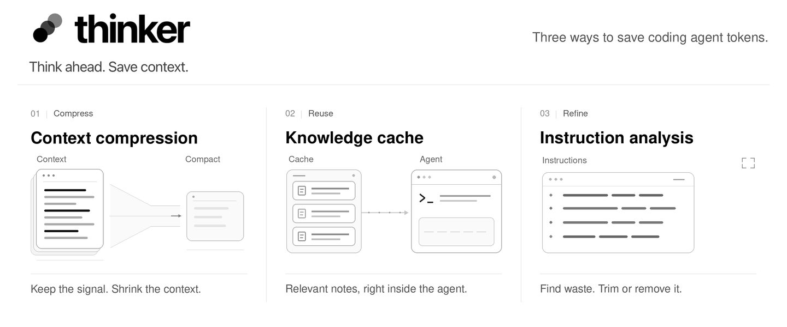

# thinker: cut wasted context



Thinker helps your coding agent use fewer tokens. Find what it loads but rarely uses,
review what to cut, and reuse what it learns about your code.

- **Find savings.** See which instructions, skills and tools consume context without helping your sessions.
- **Make the cuts.** Shorten instructions, switch off unused tools and compress long outputs. You review the changes.
- **Keep the knowledge.** Thinker learns from your sessions and brings relevant notes into future tasks, checking them as the code changes.

## Install

```bash
npx @zerotimedev/thinker
```

The installer connects your coding agents and shows suggested savings from your recent sessions.
Review them in your browser or terminal, then keep coding as usual.

Works with Claude Code, Codex, Cursor, Gemini CLI and [more](docs/agent-integrations.md).
Requires Node 20+, git and a supported agent. Free and open source.

[See how it works](https://zerotime.dev/docs#overview) · [Setup guide](docs/setup.md)

## What works with which agent

Four things thinker does, and where each one reaches. "Automatic" means the installer wires it; "by hand" means
the agent can take it once you point it there; a blank means the agent gives thinker no way in.

| Agent | Tool output compression | Knowledge cache | Instruction file optimization | Token usage analytics |
| --- | --- | --- | --- | --- |
| Claude Code (CLI, VS Code, JetBrains) | automatic: the proxy clears old tool results; per-tool caps from the Find Savings page | yes: notes on each prompt and on the files being edited, learned from every session | yes: every section, nested file and rule measured; cuts as pull requests | yes: tokens by part and by model, week by week |
| Claude desktop app (Code tab) | per-tool caps only: Desktop sets its own API URL, so the proxy cannot sit in front of it | yes, through the session itself | yes | yes |
| Codex CLI and app | no: Codex speaks only OpenAI's API, and its hooks cannot rewrite a result | yes | the root AGENTS.md measured | yes |
| Cursor (editor and `agent` CLI) | no: calls go through Cursor's servers | yes (the CLI one tool call late) | the root AGENTS.md measured | partial: Cursor reports no token usage |
| Gemini CLI | no: Google's API only | yes | the root AGENTS.md measured | partial: tool outputs only |
| pi | automatic: the proxy, through `models.json` | yes | | |
| OpenCode, Kilo Code | automatic for OpenCode (`opencode.json`); Kilo's CLI by hand | yes | | |
| Factory Droid | by hand: a custom model with the proxy as its base URL | yes | | |
| Qwen Code | by hand, on an Anthropic model provider | yes | | |
| GitHub Copilot CLI, Copilot in VS Code | by hand (the CLI, with your own Anthropic key) | yes, one tool call late | | |
| Cline | by hand: the Anthropic provider's custom base URL | yes (the CLI one tool call late) | | |
| Kiro CLI | no: Kiro's own backend | notes on each prompt (V3 engine) | | |
| Windsurf Cascade | no: Windsurf's servers | no: its hooks only record, for learning | | |
| Auggie | no: Augment's servers | notes on the files being edited | | |
| Goose | by hand (`ANTHROPIC_HOST`) | no: its hooks only record, for learning | | |

The compression is the API clearing tool results the agent has finished with, through a local proxy thinker keeps
running; it reaches any agent that speaks the Anthropic Messages API at
a base URL you can set. A section cut benefits every agent that reads the file, whichever agent's sessions
measured it. Details and the hook events behind each cell: [docs/agent-integrations.md](docs/agent-integrations.md).

## How you use it

You don't run thinker by hand. Once it is installed there are two ways in:

- **A suggestion in your session.** About once a week, once a repository has ten sessions to read, your
  agent opens its reply with a short message from thinker: one line per change worth making (what it is,
  the tokens it would have saved, the suggested action) and a link to the page. Reply with the numbers to
  approve, or "all", and the agent applies them; or ignore it and keep working.
- **The page.** `thinker ui` opens Find Savings and View Report in your browser, over every repository on
  the machine. Every part of the context is a row there, with what it costs, how often sessions use it and
  what you can cut; changes are previewed, instruction edits open as pull requests, and every cut has an
  undo. View Report tracks tokens week by week.

Everything else runs by itself: the hooks bring relevant notes into each prompt, sessions are learned from
when they end, stale notes are re-checked as the code changes, and thinker updates itself. Reports and notes
are stored locally; learning uses your existing agent's model access. See [setup and privacy](docs/setup.md).

## Uninstall

```bash
thinker uninstall --user --purge   # this repository's hooks and notes, and the machine-wide wiring
rm -rf ~/.thinker                  # the app, the ranking model and the usage log
```

To keep thinker but switch it off for one repository (sensitive content, say), run `thinker disable` there.

## Results

The cache is measured on real tasks from merged pull requests, same model with and without it:
18% fewer input tokens and 10% less wall time per task across Claude Fable, Gemini 3.8 Flash and
GPT-6 Astra, one run per arm, different tasks per model. Method, uncertainty and per-task results:
[research/bench-history/RESULTS.md](research/bench-history/RESULTS.md). The Find Savings cuts are
measured on your own sessions, as the tokens they would save; no benchmark is claimed for them yet.

## Learn more

- [Find Savings](docs/context.md): the page, what each number is, every cut and its undo
- [Setup, updates and telemetry](docs/setup.md): what the installer does, updates, telemetry and opting out
- [Usage, savings and learning](docs/usage.md): what the cache saves, the holdout comparison, how sessions are learned from
- [Skills](docs/skills.md): skill cards, the audit, what sessions say about a skill, duplicates
- [AGENTS.md](AGENTS.md): how thinker works inside, per-agent support, repository layout

## License

MIT. See [LICENSE](LICENSE).
