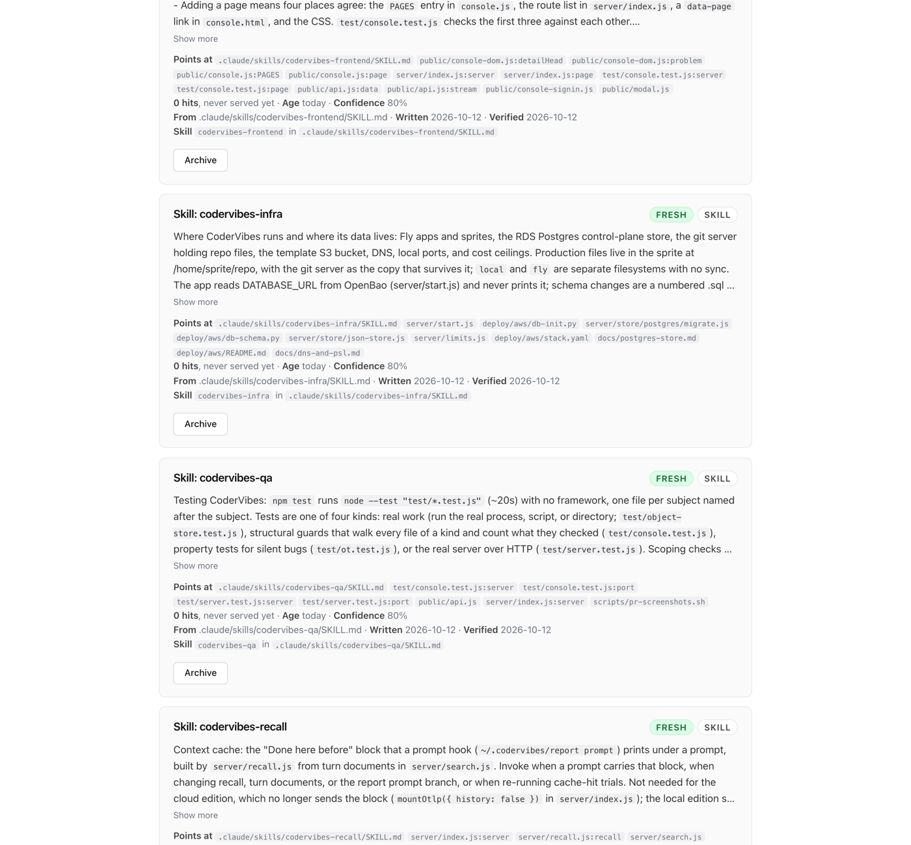

# Skills

A skill is a file (`SKILL.md`) an agent pulls into its context by name: how to run the tests here,
how to deploy, how to add a webhook. Its instructions rest on code that moves, so a skill decays
the way a note does. Thinker treats the skill files checked into a repository as cached knowledge:
each gets a card, the card is audited against the code, and the sessions that invoke the skill grade
it. Nothing here edits a skill file.

## Cards

A skill file under `.claude/skills`, `.agents/skills`, `.codex/skills`, `.cursor/skills`,
`.github/skills` or `skills/` gets a note of kind `skill`: a short card saying what the skill is
for, when to invoke it and what it prescribes, with `path:Symbol` pointers at the code it talks
about. The card is served like any note, and tells the agent to invoke the skill for the full
instructions. Its dependencies are the skill file itself and the code the skill names, so the card
goes stale when either changes.

Maintenance cards new and changed skill files a few at a time (`skills` and `skillsPerRun` in
`maintain` of `.thinker/config.json`); a build cards them all. By hand:

```bash
thinker skills                 # every skill with its state, evidence and issues
thinker skills scan [--dry]    # card new or changed skill files
```

A changed file is read again and its card rewritten. A removed file retires its card.

## Audit

When code a skill talks about changes, the card is stale and waits for a maintenance run like any
note. The audit then reads the skill file against the current code and answers one question: does
the code contradict something the skill states? A path or definition that no longer exists, a
command or flag that is gone, a procedure the code no longer supports, a rule the code now does the
opposite of. A skill that is merely incomplete or silent about a change holds.

A skill the code contradicts is **out of date**. Each issue is recorded on the card (the claim,
what the code shows instead, where), the maintenance notice names the skill, and `thinker skills`
and the local page (`thinker ui`) list the issues. An out-of-date skill is not served, and it is not
audited again: no model call is spent on it until its file changes (someone fixed it; the card is
rewritten and the skill is back) or a person marks it reviewed:

```bash
thinker skills audit <id>      # audit one skill now
thinker skills review <id>     # a person looked at it: serve and audit it again
```

The same button is on the card in `thinker ui`:



## What the sessions say

When a session invokes a skill, the distillation of that session assesses the skill like an
injected note: confirmed when the agent followed its instructions and they worked, contradicted
when something the skill prescribes failed or the code the agent read disagrees with it, unused
when the agent took another route and nothing failed. A confirmation raises the card's confidence;
a contradiction records the issue and marks the skill out of date, as the audit would. A session
that ended before the skill's present text was committed saw another version of it and is not
counted against this one.

## Several skills for the same thing

The same skill in two roots (one for Claude Code, one for Codex), or two skills whose description
and card say the same, form a group. One is served; the others are archived as its duplicates and
restored if the choice changes. The choice, in order: a person's pin, not out of date, more
confirmations than contradictions from sessions, the root the agents look in first, the newer file.

```bash
thinker skills prefer <id>     # pin one; kept in skills.prefer of .thinker/config.json
thinker skills dedupe --dry    # show the groups
```

## What stays as it is

How-to notes are the cache's own skills, written from sessions and pull requests. They are not
turned into skill files, and skill files are not turned into how-to notes.
